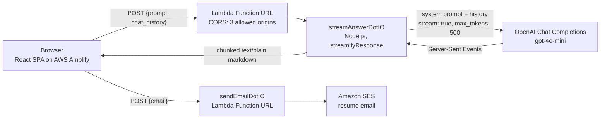

# carlotorib.io

Portfolio site for Carlo Toribio, AI Architect. The centerpiece is an AI chatbot that answers questions about Carlo's experience, streamed token by token from a serverless backend.

Live: https://carlotorib.io

## Architecture



**Request path**
1. The browser posts the question and the conversation so far. `chat_history` is a list of strings prefixed `[user] ` or `[assistant] `.
2. The Lambda adds the system prompt, which lives only on the server, and calls OpenAI with streaming on.
3. The Lambda parses OpenAI's Server-Sent Events and writes only the text deltas back to the response stream.
4. The browser reads the stream with `ReadableStream.getReader()` and a `TextDecoder`, and renders the markdown as it arrives.

## Design decisions

| Decision | Why | Tradeoff |
|---|---|---|
| Lambda Function URLs instead of API Gateway | Native response streaming, no extra service, near-zero idle cost | No built-in throttling or API keys, so the Lambda must protect itself |
| Stream the answer instead of buffering it | Words appear as soon as the model produces them instead of after the full completion | The client has to handle partial chunks and mid-stream failures |
| Plain `fetch` from the browser, no AWS SDK | No credentials in the client bundle; smaller bundle | The endpoints are public by design |
| System prompt only on the server | The client can't read or replace it | Changing the bot's knowledge means redeploying the Lambda |
| Raw markdown over the wire instead of JSON | Each chunk can be appended and rendered directly | No metadata channel (sources, token counts) in the response yet |

## Cost and abuse controls

In place today:
- `max_tokens: 500` per answer on a small, low-cost model
- CORS restricted to the production, dev and local origins
- A 5-question limit per visitor, enforced in the browser

Planned (the browser limit is bypassable with curl, so the Lambda needs its own):
- Prompt and history length caps, and accepting only `user` and `assistant` roles from the client
- Per-IP rate limiting
- A Turnstile check verified server-side before any OpenAI or SES call
- OpenAI spend limits and an AWS budget alert

## Roadmap

SEO content work, deferred for now (technical SEO is done: crawlable HTML, structured data, sitemap, canonical tag, noindex on dev):
- About / Experience page plus 2-3 case studies (RAG HR assistant, 7-year data validation at 99.8% accuracy, cash flow forecasting), aimed at searches like "AI Architect San Diego" and "RAG engineer"
- Blog, reusing the `devin/blog-feature` branch. It uses hash routes (`#/blog`), which Google never indexes, so switch to real paths (`/blog/<slug>`), prerender each post's HTML and add each post to `public/sitemap.xml`
- Every route serves the same `index.html` today, so new pages need prerendering to get their own title, description and canonical tag

## Running locally

```sh
npm ci
cp .env.example .env.local   # fill in the Function URLs and copy
npm start                    # http://localhost:3000
```

`npm run build` creates the production build in `build/`. Amplify then runs `javascript-obfuscator` on it (see `amplify.yml`). Every `REACT_APP_*` value is baked into the public bundle, so never put secrets in them.

## Repository map

- `src/components/chat/` holds the chat input, suggestions and the stream reader
- `src/components/chat-item/` renders questions and streamed markdown answers
- `src/services/OpenAIService.js` calls the two Function URLs
- `lambdas/StreamAnswerDotIO.js` is the streaming Lambda (its system prompt is kept out of the repo)
